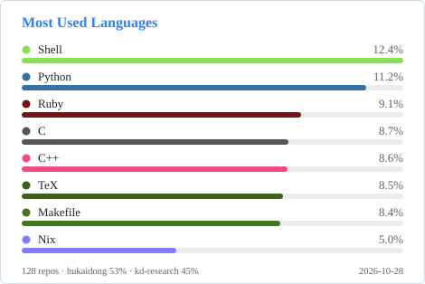

## I am Kaidong Hu 👋
:kd-main: link:https://github.com/hukaidong?tab=repositories[💅Personal]
:kd-research: link:https://github.com/orgs/kd-research/repositories[🔭Researches]
:kd-gems: link:https://github.com/orgs/kd-gems/repositories[💎Gems]
:kd-docs: link:https://github.com/orgs/kd-docs/repositories[📖Documents]
:code-stats: https://wakatime.com/share/@868b96f2-a347-41ef-b38c-e311088edc60/9d960c6d-70b2-402b-82a1-0b0be379e15e.svg

[subs="+quotes,macros"]
----
*====     🍥🍥 https://www.hukaidong.com/[Kaidong's Posts] 🍥🍥     ====*
----

### I'm splitting repository into following parts:
[cols="a,a"]
|===
a| {kd-main}::  Webs, Posts, Shell profiles, etc..
{kd-research}:: Reseach projects
{kd-gems}:: Ruby gems
{kd-docs}:: Documents that doesn't fits in a post `and` research notes
a| image::{code-stats}[programming languages spent over time,470,410,opts="interactive"]
|===

'''
### Languages across my repositories

_Aggregated across my personal and organization repositories, weighted by code volume, repository count, and my share of commits in each repo._

'''
### Also please take a glance on my favorite repos:

[comment]
--
**hukaidong/hukaidong** is a ✨ _special_ ✨ repository because its `README.md` (this file) appears on your GitHub profile.

Here are some ideas to get you started:

- 🔭 I’m currently working on ...
- 🌱 I’m currently learning ...
- 👯 I’m looking to collaborate on ...
- 🤔 I’m looking for help with ...
- 💬 Ask me about ...
- 📫 How to reach me: ...
- 😄 Pronouns: ...
- ⚡ Fun fact: ...
--
